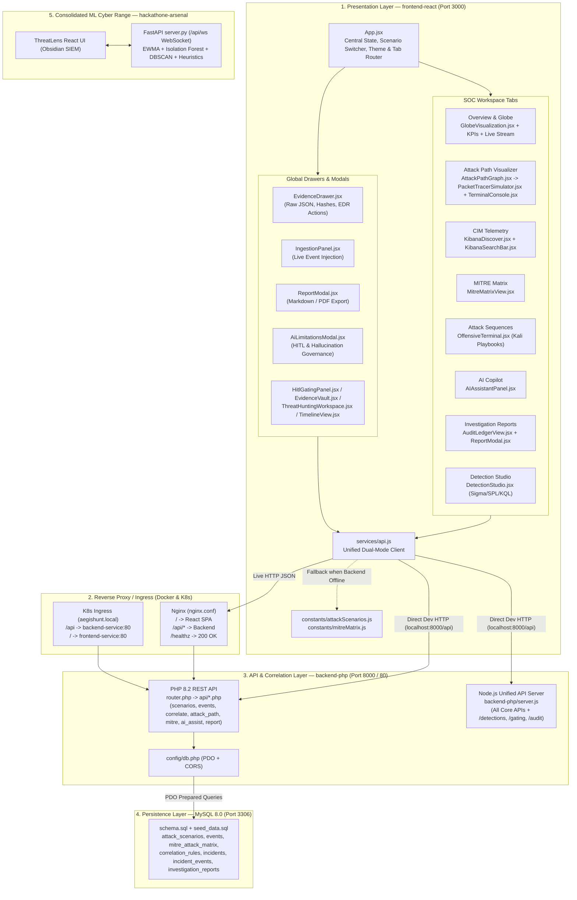

# EXPLAIN.md — Complete Architecture, Working Principles & Connection Guide

> **Platform:** Sh4d0w_Br0k3rs — Cyber Arena (AI-Assisted Cyber Threat Hunting, Attack Path Visualization & Autonomous SOC Platform)  
> **Repository:** https://github.com/Noor-Hassan-B/Cyber-Arena/

This document explains **everything** inside the Cyber Arena repository: what each layer does, how every file and component is connected, how telemetry flows from ingestion to visualization and containment, and how the platform runs in local, Docker, Kubernetes, and ThreatLens ML modes.

---

## 1. What This Project Is

**Sh4d0w_Br0k3rs (Cyber Arena)** is a full-stack Security Operations Center (SOC) threat hunting and cyber-range platform designed to solve alert fatigue and fragmented telemetry in hybrid enterprise environments.

Instead of forcing analysts to manually pivot across separate EDR, Active Directory, Network, and Cloud logs, the platform:
1. **Ingests & Normalizes** multi-source telemetry into a unified Common Information Model (**CIM**) schema covering 4 orthogonal domains: `endpoint`, `auth`, `network`, and `cloud`.
2. **Correlates** events across users, hosts, IP addresses, and sliding time windows to reconstruct multi-stage adversarial campaigns.
3. **Visualizes** attacks through an interactive **3D Global Threat Origin Map**, a **Cisco Packet Tracer Network Simulator**, a **Directed Kill-Chain Graph**, and a **12-Tactic MITRE ATT&CK Heatmap**.
4. **Simulates Red-Team Operations** via an interactive **Offensive Kali Terminal** whose attack playbooks emit live telemetry straight into the defensive correlation pipeline.
5. **Grounds AI Investigations in Evidence** through an **AI Threat Copilot** that cites deterministic `[EVT-...]` event UUIDs—every badge opens a forensic **Evidence Drawer** showing raw JSON payloads, hashes, and command lines.
6. **Enforces Governance** via a **Detection Engineering Studio** (Sigma/SPL/KQL), a **Human-in-the-Loop (HITL) Action Gating Queue**, and a SHA-256 signed **Append-Only Audit Ledger**.
7. **Consolidates a Real-Time ML Cyber Range** (`hackathone-arsenal/` — **ThreatLens SOC**), adding a Python FastAPI WebSocket streaming backend with a 4-model ML ensemble (EWMA, Isolation Forest, DBSCAN, Heuristic Correlation).

---

## 2. End-to-End Architecture & How Everything Connects

---

## 3. Deep Dive: How Each Subsystem Works

### 3.1 The Dual-Mode Engine (`frontend-react/src/services/api.js`)
One of the most important architectural decisions in this project is **resilient dual-mode operation**:

1. **Startup Probe:** When `App.jsx` mounts, it calls `api.checkBackendHealth()`, which sends a `GET http://localhost:8000/api/scenarios` request with a `1200ms` abort timeout.
2. **Live Backend Mode (`useLiveBackend = true`):** If either the **PHP 8.2 + MySQL** server or the **Node.js `server.js`** API responds with HTTP `200`, every API call (`getScenarios`, `getEvents`, `ingestEvent`, `getCorrelation`, `getAttackPath`, `getMitreData`, `getAiSummary`, `getAiQuerySuggestions`, `askAiCustomQuery`, `getInvestigationReport`) fetches live JSON from `http://localhost:8000/api/*`.
3. **Offline Embedded Engine Mode (`useLiveBackend = false`):** If no backend server is running, `api.js` transparently switches to its built-in JavaScript correlation engine backed by `src/constants/attackScenarios.js` and `src/constants/mitreMatrix.js`:
   - `calculateLocalCorrelation()` walks events chronologically, linking consecutive steps by shared `user_id`, host pivot (`source_host`/`dest_host`), network IP convergence, or cross-domain kill-chain transition, and computes a bounded confidence score:
     $$\text{confidence} = \min\!\big(0.98,\; \max(0.70,\; 0.10 \times |\text{domains}| + 0.08 \times |\text{tactics}| + 0.35)\big)$$
   - `generateLocalGraph()` extracts unique asset nodes (`c2_server`, `cloud_resource`, `server`, `endpoint`), builds directed edges tagged with MITRE technique IDs and `event_uuid`s, and calculates blast radius (`total_assets`, `high_risk_pivots`, `compromised_identities`).
   - `ingestEvent()` appends custom events to `this.customEvents` with generated `EVT-ING-XXXXXX` UUIDs so all charts, graphs, timelines, and reports update live without needing a database!

---

### 3.2 Central Frontend Orchestrator (`frontend-react/src/App.jsx`)
`App.jsx` is the single source of truth for the UI:

- **Top Status Bar:** Shows DEFCON threat hunting status, CIM normalization indicator, **White / Dark Theme toggle** (persisted in `localStorage` under `aegis_theme`, defaulting to crisp White Theme), and runtime status.
- **Header Bar:**
  - **Brand:** `Sh4d0w_Br0k3rs AI-SOC`
  - **Scenario Switcher:** Switches between loaded scenarios (`SCN-APT29-GHOST`, `SCN-RANSOM-BLACKCAT`, `SCN-CLOUD-CRYPTOMINE`, plus 5 additional offensive scenarios when connected to `server.js`). Changing a scenario fires `loadScenarioData(scenarioId)`, fetching all 6 datasets in parallel via `Promise.all`.
  - **Global IOC Search:** Filters events in real time across `event_uuid`, `domain`, `event_type`, `severity`, `source_host`, `dest_host`, `user_id`, and `mitre_technique_id`.
  - **Severity Counters:** Live `CRIT` and `HIGH` pill badges.
  - **Reset to 0 / Restore Stats Button (`isResetToZero`):** Interactively zeroes out all KPI counters, telemetry breakdown bars, velocity/coverage rings, and clears the live feed to `0` for clean demo resets, then restores baseline telemetry with one click.
  - **Ingest Telemetry Button:** Opens `IngestionPanel.jsx`.
  - **Correlating / Idle Button:** Re-triggers `loadScenarioData()` on demand.
- **Left Sidebar & Horizontal Tab Navigation:** Switches between 8 primary views:
  1. `globe` — **Overview & Globe** (`GlobeVisualization.jsx` + KPI cards + domain breakdown + live stream)
  2. `graph` — **Attack Path Visualizer** (`AttackPathGraph.jsx` -> embeds `PacketTracerSimulator.jsx` + `TerminalConsole.jsx`)
  3. `discover` — **CIM Telemetry** (`KibanaDiscover.jsx` + `KibanaSearchBar.jsx`)
  4. `mitre` — **MITRE Matrix** (`MitreMatrixView.jsx`)
  5. `terminal` — **Attack Sequences** (`OffensiveTerminal.jsx`)
  6. `ai` — **AI Copilot** (`AIAssistantPanel.jsx`)
  7. `audit` — **Investigation Reports & Audit Ledger** (`AuditLedgerView.jsx` + buttons for `ReportModal.jsx` and `AiLimitationsModal.jsx`)
  8. `detection` — **Detection Studio** (`DetectionStudio.jsx`)

---

### 3.3 How Interactive Modules Connect Together

| Interaction | What Happens Under the Hood |
|---|---|
| **Click any event row, graph edge, MITRE cell, or AI `[EVT-...]` badge** | Calls `handleSelectEvent(eventUuid)` in `App.jsx` ➔ resolves the event from `events` state ➔ opens `EvidenceDrawer.jsx` with timestamp, process tree, CLI args, hashes, raw JSON payload, and one-click EDR containment triggers (which show a toast notification). |
| **Run an attack in `OffensiveTerminal.jsx` or `TerminalConsole.jsx`** | Calls `onCommandExecuted(actionData)` ➔ `handleTerminalCommand()` in `App.jsx` ➔ `api.ingestEvent(actionData)` (`POST /api/events`) ➔ re-runs `loadScenarioData(activeScenarioId)` ➔ immediately updates the Globe, Attack Path Graph, Packet Tracer, MITRE Heatmap, and CIM Discover! |
| **Inject a custom event via `IngestionPanel.jsx`** | Lets analysts pick a preset (Certutil Download Cradle `T1105`, VPN Spray `T1078`, DNS Tunneling `T1071.004`, AWS CloudTrail Tampering) or author a custom event ➔ `POST /api/events` ➔ triggers `onEventIngested()` ➔ refreshes entire dashboard. |
| **Switch Graph Modes in `AttackPathGraph.jsx`** | Supports 3 views: **Cisco Packet Tracer** (`PacketTracerSimulator.jsx`, animating live packets across `C2-Adversary-Cloud`, `ASA-5506-X` firewall, core router/switch, endpoints, and cloud), **Linear Kill-Chain**, and **Topology Graph** with auto-playback. |
| **Deploy a Detection Rule in `DetectionStudio.jsx`** | Sends `POST /api/detections` with Sigma YAML, Splunk SPL, or Elastic KQL ➔ `server.js` stores the rule and automatically appends a signed `CREATE_DETECTION_RULE` record to `DB.auditLedger`. |
| **Approve/Reject Containment in `HitlGatingPanel.jsx`** | Sends `POST /api/gating` with `{ action_id, decision, analyst_name, reason }` ➔ updates action status to `approved_and_executed` or `rejected_by_analyst` ➔ appends a signed `HITL_ACTION_APPROVED` / `HITL_ACTION_REJECTED` entry to `DB.auditLedger`. |
| **Export Forensic Report in `ReportModal.jsx`** | Calls `api.getInvestigationReport(scenarioId, analystName)` ➔ builds Executive Summary, Chronological Timeline, Evidence Chain of Custody, MITRE Coverage, and 3-Phase Containment Playbook ➔ exports as `.md` download or printable PDF. |

---

### 3.4 Backend Options & Relational Database Schema (`backend-php/`)

#### Option A: PHP 8.2 + MySQL 8.0 (`backend-php/router.php`, `api/*.php`, `config/db.php`)
- **`router.php`** (local CLI) and **`apache.conf`** (Docker/K8s) handle CORS preflights and route clean paths (`/api/events`) to PHP scripts (`api/events.php`).
- **`config/db.php`** creates a singleton PDO connection using environment variables (`DB_HOST`, `DB_PORT`, `DB_NAME`, `DB_USER`, `DB_PASS`).
- **`sql/schema.sql`** defines 7 normalized InnoDB tables:
  1. `attack_scenarios` — Scenario metadata (`scenario_id`, threat actor, vector, impact).
  2. `events` — Normalized CIM telemetry across `endpoint`, `auth`, `network`, `cloud` with composite index `(scenario_id, timestamp)` and indexes on `domain`, `severity`, `user_id`, `source_host`, `dest_ip`, `mitre_technique_id`, plus `raw_payload JSON`.
  3. `mitre_attack_matrix` — MITRE ATT&CK tactic & technique reference catalog.
  4. `correlation_rules` — Sliding-window cross-domain correlation rule definitions.
  5. `incidents` — Reconstructed incidents linked via FK to `attack_scenarios`.
  6. `incident_events` — Many-to-many chain-of-custody junction linking `incidents` to `events` with `sequence_order` and `correlation_reason`.
  7. `investigation_reports` — Persisted executive & technical forensic reports linked via FK to `incidents`.
- **`seed.php`** automates creating the database and executing `schema.sql` and `seed_data.sql`.

#### Option B: Zero-Dependency Node.js Unified API Server (`backend-php/server.js`)
- Runs natively with `node server.js` on port `8000` (or `PORT` env var) with zero external packages.
- Serves **all 8 scenarios** (3 core enterprise/cloud scenarios + 5 consolidated Hackathone offensive scenarios) and **all 11 REST endpoints**, including the SOC governance routes (`/api/detections`, `/api/gating`, `/api/audit`) that write cryptographically hashed entries into the append-only Audit Ledger on every ingestion, rule creation, or HITL decision.

---

### 3.5 Docker Compose & Kubernetes Connectivity

#### Docker Compose (`docker-compose.yml`)
Three containers run on the isolated bridge network `aegishunt-network`:
1. **`aegishunt-mysql` (`mysql:8.0`, host `:3306`)** — Mounts `schema.sql` as `01_schema.sql` and `seed_data.sql` as `02_seed_data.sql` in `/docker-entrypoint-initdb.d/`. Exposes a `mysqladmin ping` healthcheck.
2. **`aegishunt-backend` (`php:8.2-apache-bullseye`, host `:8000 -> 80`)** — Waits for `mysql: service_healthy`, connects to `DB_HOST=mysql`, and exposes `/api/*` with a `curl /api/scenarios` healthcheck.
3. **`aegishunt-frontend` (`nginx:1.27-alpine`, host `:3000 -> 80`)** — Multi-stage build compiles React with `node:20-alpine` into `/usr/share/nginx/html`. `nginx.conf` serves the SPA (`try_files $uri /index.html`), exposes `/healthz`, adds security headers (`X-Frame-Options`, `X-Content-Type-Options`), and proxies `/api/` directly to `http://backend:80/api/`.

#### Kubernetes (`k8s/`)
Managed via `kubectl apply -k ./k8s` (`kustomization.yaml`) inside the `threat-hunting` namespace:
- `01-configmap.yaml` & `02-secrets.yaml` inject DB config and credentials.
- `03-mysql-pvc.yaml` & `04-mysql-init-configmap.yaml` give MySQL persistent storage and auto-seeding.
- `05-mysql-deployment.yaml`, `06-backend-deployment.yaml`, and `07-frontend-deployment.yaml` deploy the 3 tiers with ClusterIP services.
- `08-ingress.yaml` configures Nginx Ingress on host `aegishunt.local`: `/api` ➔ `backend-service:80`, `/` ➔ `frontend-service:80`.
- `09-hpa.yaml` attaches a HorizontalPodAutoscaler for automatic scaling under telemetry load.

---

### 3.6 Consolidated Cyber Range (`hackathone-arsenal/`)
Located under `hackathone-arsenal/`, **ThreatLens SOC** is an autonomous streaming detection sub-platform built with:
- **Backend (`app/backend/server.py`):** Python FastAPI server with real-time WebSocket streaming (`/api/ws`) and a 4-model ML Consensus Engine:
  - **EWMA Moving Baseline** (`T1110.003` — low-and-slow SSH password spraying)
  - **Isolation Forest** (`T1078` — ghost transactions & p99 latency spikes)
  - **DBSCAN Density Clustering** (`T1110.004` — distributed credential stuffing across rotating proxies)
  - **Heuristic Correlation** (`T1595.001` / `T1190` — Nmap SYN scans & SQL injection)
- **Frontend (`app/frontend/`):** React + Vite Obsidian SIEM UI featuring a dynamic risk threshold slider (`50–90`), split-screen Kali console, SDN hypervisor isolation, and Markdown/CSV incident export.
- **Reports (`hackathone-arsenal/reports/`):** 4 detailed architectural & dataflow documents.

---

## 4. Synthetic Attack Scenarios Catalog

| Scenario ID | Scenario Name | Domains Covered | Key MITRE Techniques |
|---|---|---|---|
| `SCN-APT29-GHOST` | **Operation GhostToken: Hybrid Enterprise Infiltration** | Endpoint, Network, Auth, Cloud | `T1566.001` (Spearphish) ➔ `T1059.001` (PowerShell) ➔ `T1071.001` (C2) ➔ `T1003.001` (LSASS Dump) ➔ `T1558.003` (Kerberoasting) ➔ `T1047` (WMI) ➔ `T1552.001` (AWS Creds) ➔ `T1078.004` (STS AssumeRole) ➔ `T1530` (S3) ➔ `T1048` (Exfil) |
| `SCN-RANSOM-BLACKCAT` | **Double-Extortion Ransomware Campaign** | Auth, Endpoint, Network | `T1133` (VPN) ➔ `T1021.001` (RDP) ➔ `T1490` (VSS Purge) ➔ `T1567.002` (Cloud Exfil) ➔ `T1486` (Encryption) |
| `SCN-CLOUD-CRYPTOMINE` | **Cloud-Native IAM Hijack & Compute Hijacking** | Cloud, Network | `T1098` (Access Key) ➔ `T1078.004` (Admin Policy) ➔ `T1562.008` (Stop CloudTrail) ➔ `T1496` (16x GPU EC2 Cryptomining) |
| `SCN-BRUTE-FORCE` | **Hydra Low-and-Slow SSH Spray** *(Unified API)* | Auth, Network | `T1110.003` (Throttled Password Spraying) |
| `SCN-CRED-STUFFING` | **Distributed Credential Stuffing (19 Proxies)** *(Unified API)* | Auth, Network | `T1110.004` (Credential Stuffing) |
| `SCN-PORT-SCAN` | **Nmap SYN Stealth Reconnaissance** *(Unified API)* | Network | `T1595.001` (Active Scanning) |
| `SCN-SQL-INJECTION` | **Automated SQLMap Database Extraction** *(Unified API)* | Network, Endpoint | `T1190` (Exploit Public-Facing Application) |
| `SCN-GHOST-TX` | **Ghost Transactions / Shadow Replay** *(Unified API)* | Network, Cloud | `T1078` (Shadow API Replay & Latency Spike) |
