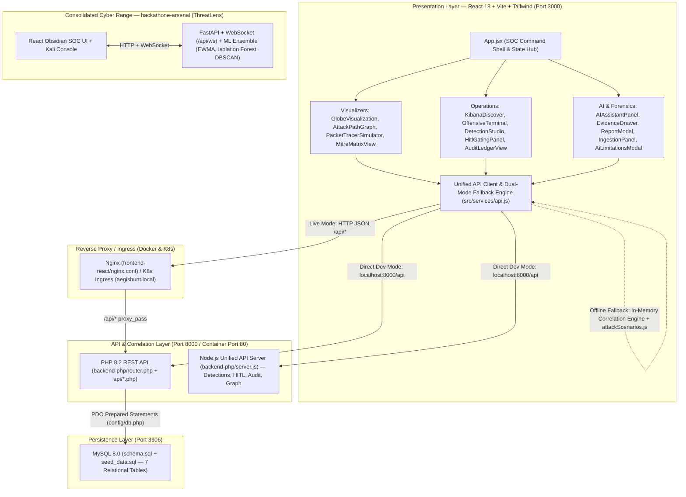

# Sh4d0w_Br0k3rs — Cyber Arena: AI-Assisted Threat Hunting, Attack Path Visualization & SOC Platform

[](https://react.dev/)
[](https://tailwindcss.com/)
[](https://www.php.net/)
[](https://www.mysql.com/)
[](https://fastapi.tiangolo.com/)
[](https://www.docker.com/)
[](https://kubernetes.io/)
[](https://attack.mitre.org/)

**Sh4d0w_Br0k3rs (Cyber Arena)** is a full-stack, evidence-driven **AI-Assisted Cyber Threat Hunting, Attack Path Visualization, and Autonomous SOC Platform**. It ingests multi-source security telemetry across **Endpoint (Sysmon/EDR)**, **Identity/Auth (Active Directory/Kerberos/VPN)**, **Network (Zeek/NetFlow)**, and **Cloud (AWS CloudTrail/STS/S3)** domains, normalizes events into a Common Information Model (CIM), correlates adversarial chains across entities and time windows, reconstructs interactive attack graphs & Cisco Packet Tracer network simulations, and equips SOC analysts with an AI Threat Copilot strictly grounded in deterministic `[EVT-...]` evidence citations.

This repository also consolidates the **Hackathone Arsenal (ThreatLens SOC)**—a FastAPI + React real-time streaming red-team/blue-team cyber range powered by an unsupervised multi-modal ML ensemble (EWMA, Isolation Forest, DBSCAN, and Heuristic Correlation).

---

## Table of Contents

1. [Platform Capabilities & Modules](#platform-capabilities--modules)
2. [How Everything Is Connected (Architecture & Data Flow)](#how-everything-is-connected-architecture--data-flow)
3. [Complete Repository Tree](#complete-repository-tree)
4. [Frontend Component Wiring (`frontend-react`)](#frontend-component-wiring-frontend-react)
5. [Backend API & Datastore Layer (`backend-php`)](#backend-api--datastore-layer-backend-php)
6. [Consolidated Red/Blue Cyber Range (`hackathone-arsenal`)](#consolidated-redblue-cyber-range-hackathone-arsenal)
7. [Containerization & Kubernetes Topology](#containerization--kubernetes-topology)
8. [Quick Start Guides](#quick-start-guides)
9. [AI Limitations & Human-in-the-Loop Governance](#ai-limitations--human-in-the-loop-governance)

---

## Platform Capabilities & Modules

| Module / Feature | Description | Primary Implementation |
|---|---|---|
| **1. Overview & 3D Threat Origin Globe** | Real-time SOC KPI dashboard, domain telemetry breakdown, 3D threat-origin globe mapping Attack Origins, Pivot Nodes, and Exfiltration Targets, live event stream, **White/Dark theme toggle**, and **Reset Statistics to Zero / Restore** control. | `App.jsx`, `GlobeVisualization.jsx`, `OverviewStats.jsx` |
| **2. Attack Path Visualizer & Cisco Packet Tracer Simulator** | Interactive cyber kill-chain visualization supporting three modes: **Cisco Packet Tracer** (animated packet traversal across ASA firewalls, routers, switches, endpoints, and C2 cloud), **Linear Kill-Chain**, and **Topology Graph** with blast-radius metrics and clickable evidence edges. | `AttackPathGraph.jsx`, `PacketTracerSimulator.jsx`, `TerminalConsole.jsx` |
| **3. CIM Telemetry & Kibana Discover** | Searchable, filterable Common Information Model (CIM) telemetry explorer supporting IOC, host, user, hash, IP, and MITRE technique queries across Endpoint, Auth, Network, and Cloud logs. | `KibanaDiscover.jsx`, `KibanaSearchBar.jsx`, `TimelineView.jsx` |
| **4. MITRE ATT&CK Enterprise Heatmap** | 12-tactic enterprise matrix mapping observed adversarial techniques, hit counts, severity badges, and one-click drill-down into correlated raw events. | `MitreMatrixView.jsx`, `mitreMatrix.js` |
| **5. Offensive Kali Terminal & Attack Sequences** | Interactive red-team offensive console with built-in attack playbooks (`nmap` SYN stealth scan, `hydra` low-and-slow SSH spray, credential stuffing, SQLMap extraction, ghost transaction replay) that emit live telemetry directly into the defensive correlation pipeline. | `OffensiveTerminal.jsx`, `TerminalConsole.jsx` |
| **6. Evidence-Linked AI Threat Copilot** | Generates executive threat summaries, hypotheses, and ready-to-run SIEM hunt queries (**SPL** & **SQL**) where every claim is deterministically linked to `[EVT-...]` UUID citations that open the forensic Evidence Drawer. | `AIAssistantPanel.jsx`, `EvidenceDrawer.jsx`, `AiLimitationsModal.jsx` |
| **7. Detection Engineering Studio** | Author, inspect, and deploy detection rules across **Sigma (YAML)**, **Splunk SPL**, and **Elastic KQL**, automatically tagged with MITRE ATT&CK tactics and logged to the Audit Ledger. | `DetectionStudio.jsx`, `backend-php/server.js` |
| **8. Human-in-the-Loop (HITL) Gating & Audit Ledger** | High-impact containment actions (`isolate_host`, `revoke_session`, `block_ip`) are queued for analyst approval with blast-radius impact analysis; all decisions and ingestions are recorded in a SHA-256 signed append-only Audit Ledger. | `HitlGatingPanel.jsx`, `AuditLedgerView.jsx`, `EvidenceVault.jsx` |
| **9. Live Telemetry Ingestion & Forensic Reports** | Inject synthetic attack events on demand and export executive forensic incident reports (timeline, chain of custody, MITRE coverage, 3-phase containment playbook) as Markdown or printable PDF. | `IngestionPanel.jsx`, `ReportModal.jsx` |
| **10. Dual-Mode Resilient Engine** | The React dashboard auto-probes the backend (`http://localhost:8000/api`) on startup. If the PHP/MySQL or Node.js API is online, it uses live REST endpoints; if offline, it seamlessly falls back to its built-in in-memory correlation engine so the platform works immediately out of the box. | `frontend-react/src/services/api.js` |

---

## How Everything Is Connected (Architecture & Data Flow)

### High-Level System Architecture



### End-to-End Telemetry Lifecycle

```text
[1] Telemetry Source / Offensive Playbook
    ├── Pre-seeded Scenarios (APT29 GhostToken, BlackCat Ransomware, AWS IAM Cryptomining,
    │   Hydra SSH Spray, Credential Stuffing, Nmap SYN Scan, SQLMap, Ghost Transactions)
    ├── Live Ingestion Workbench (IngestionPanel.jsx -> POST /api/events)
    └── Offensive Kali Terminal (OffensiveTerminal.jsx / TerminalConsole.jsx -> handleTerminalCommand())
            │
            ▼
[2] Unified Service & Dual-Mode Router (frontend-react/src/services/api.js)
    ├── Health Check on Boot: GET /api/scenarios (1200ms timeout)
    ├── Online  ──► Routes calls to PHP 8.2 API (router.php -> api/*.php -> MySQL)
    │               or Node.js API (server.js -> In-Memory Store + Detections/HITL/Audit)
    └── Offline ──► Executes local correlation, graph builder, MITRE mapper & report generator
                    using constants/attackScenarios.js & constants/mitreMatrix.js
            │
            ▼
[3] Cross-Domain Correlation & Graph Reconstruction
    ├── Temporal + Entity Sliding Window (pivots on user_id, source_host, dest_host, IPs)
    ├── Attack Path Graph Generator (classifies c2_server, cloud_resource, server, endpoint)
    └── MITRE ATT&CK Mapper (aggregates tactic coverage, hit counts, and event_uuids)
            │
            ▼
[4] Interactive Analyst Views & Evidence Linkage
    ├── Any click on a globe event, graph edge, MITRE tile, timeline row, or AI [EVT-...] badge
    │   calls handleSelectEvent(eventUuid) in App.jsx
    ├── Opens EvidenceDrawer.jsx with raw JSON payload, hashes, CLI args & EDR containment triggers
    ├── High-risk actions flow through HitlGatingPanel.jsx -> POST /api/gating -> AuditLedgerView.jsx
    └── One-click Forensic Report generation via ReportModal.jsx -> GET /api/report (PDF / Markdown)
```

---

## Complete Repository Tree

```text
Cyber-Arena/
├── README.md                                  # Master documentation, architecture & connection guide
├── .env.example                               # Environment variable template (DB, ports, API)
├── .gitignore                                 # Ignores node_modules, vendor, dist, .env, mysql_data
├── docker-compose.yml                         # 3-tier Docker Compose stack (MySQL + PHP API + React/Nginx)
├── deploy-docker.ps1 / deploy-docker.sh       # One-command Docker deployment scripts (Windows / Linux)
├── deploy-k8s.ps1 / deploy-k8s.sh             # One-command Kubernetes deployment scripts (Windows / Linux)
├── push-to-github.bat                         # Quick GitHub push utility script
│
├── frontend-react/                            # Primary SOC Dashboard (React 18 + Vite 6 + Tailwind CSS)
│   ├── Dockerfile                             # Multi-stage build (Node 20 Alpine -> Nginx 1.27 Alpine)
│   ├── .dockerignore                          # Docker build exclusions
│   ├── nginx.conf                             # SPA routing, gzip, security headers, /healthz & /api proxy
│   ├── index.html                             # HTML shell & entry mount point
│   ├── package.json / package-lock.json       # React 18, Lucide Icons, Vite, Tailwind dependencies
│   ├── vite.config.js                         # Dev server on port 3000 (host: true)
│   ├── tailwind.config.js / postcss.config.js # Styling configuration
│   └── src/
│       ├── main.jsx                           # React DOM root renderer
│       ├── index.css                          # Theme tokens, scrollbar, dark/light global styles
│       ├── App.jsx                            # Main SOC workspace shell, state orchestration & tab routing
│       ├── services/
│       │   └── api.js                         # Unified API client + dual-mode offline correlation engine
│       ├── constants/
│       │   ├── attackScenarios.js             # Multi-domain synthetic datasets (APT29, BlackCat, Cloud)
│       │   └── mitreMatrix.js                 # MITRE ATT&CK 12-tactic enterprise catalog
│       └── components/
│           ├── Navbar.jsx                     # Modular SOC header & backend status bar
│           ├── OverviewStats.jsx              # KPI summary cards & blast-radius indicators
│           ├── GlobeVisualization.jsx         # Interactive 3D global threat origin & exfil map
│           ├── AttackPathGraph.jsx            # Directed SVG kill-chain graph + mode switcher
│           ├── PacketTracerSimulator.jsx      # Cisco Packet Tracer-style animated network simulator
│           ├── TerminalConsole.jsx            # Defensive/offensive interactive command console
│           ├── OffensiveTerminal.jsx          # Kali Linux red-team playbook & attack sequence emulator
│           ├── KibanaDiscover.jsx             # CIM telemetry log explorer & field inspector
│           ├── KibanaSearchBar.jsx            # Structured KQL/IOC search input bar
│           ├── TimelineView.jsx               # Chronological cross-domain event timeline
│           ├── MitreMatrixView.jsx            # 12-tactic MITRE ATT&CK interactive heatmap
│           ├── AIAssistantPanel.jsx           # AI Threat Copilot, SPL/SQL hunt queries & Q&A
│           ├── EvidenceDrawer.jsx             # Slide-out forensic telemetry inspector & EDR actions
│           ├── EvidenceVault.jsx              # Chain-of-custody artifact & evidence browser
│           ├── ThreatHuntingWorkspace.jsx     # Guided hypothesis-driven threat hunting canvas
│           ├── DetectionStudio.jsx            # Sigma / SPL / KQL detection rule authoring & deployment
│           ├── HitlGatingPanel.jsx            # Human-in-the-Loop containment approval queue
│           ├── AuditLedgerView.jsx            # SHA-256 signed append-only SOC audit log viewer
│           ├── IngestionPanel.jsx             # Live multi-source telemetry injection modal
│           ├── ReportModal.jsx                # Forensic incident report viewer & MD/PDF exporter
│           └── AiLimitationsModal.jsx         # AI risk governance, hallucination & HITL modal
│
├── backend-php/                               # REST API & Persistence Layer (PHP 8.2 + MySQL + Node.js)
│   ├── Dockerfile                             # PHP 8.2 Apache + PDO MySQL + Opcache container
│   ├── .dockerignore                          # Docker build exclusions
│   ├── apache.conf                            # Apache VirtualHost & URL rewrite rules
│   ├── docker-entrypoint.sh                   # Container startup & DB readiness/seeding entrypoint
│   ├── router.php                             # Built-in PHP CLI router (maps /api/<name> -> api/<name>.php)
│   ├── server.js                              # Zero-dependency Node.js REST API (includes Detections/HITL/Audit)
│   ├── seed.php                               # Automated MySQL schema & seed data installer
│   ├── README.md                              # Backend setup & XAMPP/CLI guide
│   ├── config/
│   │   └── db.php                             # PDO MySQL connection singleton & CORS headers
│   ├── sql/
│   │   ├── schema.sql                         # 7-table relational schema with indexes & foreign keys
│   │   └── seed_data.sql                      # Multi-source synthetic security telemetry datasets
│   └── api/
│       ├── scenarios.php                      # GET /api/scenarios — Attack scenarios catalog
│       ├── events.php                         # GET/POST /api/events — Query, filter & ingest telemetry
│       ├── correlate.php                      # GET /api/correlate — Cross-domain temporal & entity correlation
│       ├── attack_path.php                    # GET /api/attack_path — Nodes, edges & blast radius
│       ├── mitre.php                          # GET /api/mitre — MITRE ATT&CK technique heatmap data
│       ├── ai_assist.php                      # GET/POST /api/ai_assist — Hypotheses, SPL/SQL & Q&A
│       └── report.php                         # GET /api/report — Forensic timeline & incident report
│
├── k8s/                                       # Production Kubernetes Manifests (Kustomize)
│   ├── kustomization.yaml                     # Orchestrates all 10 manifests in `threat-hunting` namespace
│   ├── 00-namespace.yaml                      # Dedicated `threat-hunting` namespace
│   ├── 01-configmap.yaml                      # Non-sensitive runtime configuration
│   ├── 02-secrets.yaml                        # MySQL credentials secret
│   ├── 03-mysql-pvc.yaml                      # PersistentVolumeClaim for MySQL data
│   ├── 04-mysql-init-configmap.yaml           # SQL init scripts mounted into MySQL pod
│   ├── 05-mysql-deployment.yaml               # MySQL 8.0 Deployment & ClusterIP Service
│   ├── 06-backend-deployment.yaml             # PHP API Deployment & backend-service
│   ├── 07-frontend-deployment.yaml            # React/Nginx Deployment & frontend-service
│   ├── 08-ingress.yaml                        # Nginx Ingress (`aegishunt.local`: `/api` -> backend, `/` -> frontend)
│   └── 09-hpa.yaml                            # HorizontalPodAutoscaler for auto-scaling under load
│
├── docs/                                      # Technical Documentation & Benchmarks
│   ├── ARCHITECTURE.md                        # Deep-dive system architecture & correlation pipeline
│   ├── SCENARIOS.md                           # Step-by-step synthetic attack scenario walkthroughs
│   ├── AI_LIMITATIONS.md                      # Hallucination, base-rate fallacy & HITL governance analysis
│   ├── EVALUATION.md                          # Quantitative benchmarks & performance evaluation
│   └── CONTAINERIZATION_AND_KUBERNETES.md     # Docker Compose, K8s Ingress & HPA operations guide
│
└── hackathone-arsenal/                        # Consolidated ThreatLens SOC (FastAPI + React + ML Ensemble)
    ├── README.md                              # ThreatLens autonomous SOC documentation
    ├── LICENSE                                # MIT License
    ├── app/
    │   ├── backend/
    │   │   ├── server.py                      # FastAPI server, WebSocket hub (/api/ws) & ML consensus engine
    │   │   ├── requirements.txt               # Python backend dependencies
    │   │   └── .env.example                   # JWT & environment template
    │   └── frontend/                          # Obsidian SIEM React UI (Dashboard, Login, KaliConsole, AlertFeed)
    ├── docs/screenshots/                      # High-resolution platform screenshots
    └── reports/                               # 4 architectural & end-to-end dataflow technical reports
```

---

## Frontend Component Wiring (`frontend-react`)

`frontend-react/src/App.jsx` acts as the central state orchestrator, maintaining:
- **Global Session State:** `activeScenarioId`, `theme` (`light` / `dark`), `searchQuery`, `isResetToZero`, `backendStatus`
- **Correlated Datasets:** `events`, `correlationData`, `graphData`, `mitreData`, `aiSummary`, `querySuggestions`
- **Global Overlays:** `selectedEvent` (`EvidenceDrawer`), `showReportModal` (`ReportModal`), `showLimitationsModal` (`AiLimitationsModal`), `showIngestModal` (`IngestionPanel`)

| Navigation Tab (`App.jsx`) | Mounted Component(s) | Data Flow / Backend Endpoints |
|---|---|---|
| **Overview & Globe** (`globe`) | `GlobeVisualization`, inline KPI cards, telemetry bars, live event feed | `api.getEvents`, `api.getCorrelation` |
| **Attack Path Visualizer** (`graph`) | `AttackPathGraph` ➔ embeds `PacketTracerSimulator` + `TerminalConsole` | `api.getAttackPath`, `api.ingestEvent` |
| **CIM Telemetry** (`discover`) | `KibanaDiscover` (+ `KibanaSearchBar`) | Filtered `events` ➔ `handleSelectEvent` |
| **MITRE Matrix** (`mitre`) | `MitreMatrixView` | `api.getMitreData` ➔ `handleSelectEvent` |
| **Attack Sequences** (`terminal`) | `OffensiveTerminal` | Executes attack playbooks ➔ `api.ingestEvent` ➔ re-runs full scenario correlation |
| **AI Copilot** (`ai`) | `AIAssistantPanel` | `api.getAiSummary`, `api.getAiQuerySuggestions`, `api.askAiCustomQuery` |
| **Investigation Reports** (`audit`) | `AuditLedgerView` + triggers `ReportModal` & `AiLimitationsModal` | `GET /api/audit`, `GET /api/report` |
| **Detection Studio** (`detection`) | `DetectionStudio` | `GET /api/detections`, `POST /api/detections` |
| **Auxiliary Views / Modals** | `EvidenceDrawer`, `IngestionPanel`, `HitlGatingPanel`, `EvidenceVault`, `ThreatHuntingWorkspace`, `TimelineView` | `POST /api/events`, `GET/POST /api/gating`, `GET /api/report` |

---

## Backend API & Datastore Layer (`backend-php`)

The backend can run in **two interchangeable modes** on port `8000`:
1. **PHP 8.2 + MySQL 8.0 (`router.php` + `api/*.php` + `config/db.php`)** — Production relational store used in Docker Compose and Kubernetes.
2. **Node.js Unified Server (`backend-php/server.js`)** — Zero-dependency Node.js server providing all core endpoints **plus** `/api/detections`, `/api/gating`, and `/api/audit` in-memory.

### REST API Endpoints

| Method & Path | Handler | Purpose |
|---|---|---|
| `GET /api/scenarios` | `api/scenarios.php` / `server.js` | Returns all available attack scenarios and metadata |
| `GET /api/events?scenario_id=...` | `api/events.php` / `server.js` | Queries normalized events with optional `domain`, `severity`, and `search` filters |
| `POST /api/events` | `api/events.php` / `server.js` | Ingests a new multi-domain security event and logs it |
| `GET /api/correlate?scenario_id=...` | `api/correlate.php` / `server.js` | Runs temporal & entity correlation across users, hosts, IPs, and MITRE tactics |
| `GET /api/attack_path?scenario_id=...` | `api/attack_path.php` / `server.js` | Builds directed attack graph (`nodes`, `edges`, `critical_path`, `blast_radius`) |
| `GET /api/mitre?scenario_id=...` | `api/mitre.php` / `server.js` | Returns observed MITRE ATT&CK techniques, hit counts, and linked event UUIDs |
| `GET / POST /api/ai_assist` | `api/ai_assist.php` / `server.js` | Returns evidence-cited executive summaries, SPL/SQL hunt queries, and custom Q&A |
| `GET /api/report?scenario_id=...` | `api/report.php` / `server.js` | Generates full forensic incident timeline, custody chain, and containment playbook |
| `GET / POST /api/detections` | `server.js` | Lists and deploys Sigma / SPL / KQL detection rules (logged to Audit Ledger) |
| `GET / POST /api/gating` | `server.js` | Lists HITL containment queue and approves/rejects actions (`isolate_host`, `block_ip`, etc.) |
| `GET /api/audit` | `server.js` | Retrieves the SHA-256 signed append-only SOC Audit Ledger |

### MySQL Relational Schema (`backend-php/sql/schema.sql`)

```text
attack_scenarios (1) ──────< (N) incidents (1) ──────< (N) investigation_reports
                                     │
                                     │ (1:N)
                                     ▼
                              incident_events (Chain of Custody Junction)
                                     ▲
                                     │ (1:N)
events (Normalized Telemetry) ───────┘
  └── indexed by: (scenario_id, timestamp), domain, severity, user_id, source_host, dest_ip, mitre_technique_id

mitre_attack_matrix (Reference Catalog)      correlation_rules (Sliding-Window Rules)
```

---

## Consolidated Red/Blue Cyber Range (`hackathone-arsenal`)

Located in [`hackathone-arsenal/`](hackathone-arsenal/), this integrated sub-platform (**ThreatLens SOC**) adds a Python FastAPI streaming backend and Obsidian-themed React dashboard featuring:
- **Real-time WebSocket Engine (`/api/ws`)** tracking live EPS (Events Per Second) across Auth, NetFlow, and Payment Ledger streams
- **4-Model ML Consensus Detector:** EWMA Moving Baseline (`T1110.003`), Isolation Forest (`T1078`), DBSCAN IP Density Clustering (`T1110.004`), and Heuristic Correlation (`T1595.001` / `T1190`)
- **Split-Screen Kali Linux Console & Dynamic Risk Threshold Slider (`50–90`)**
- Full architectural reports in [`hackathone-arsenal/reports/`](hackathone-arsenal/reports/)

---

## Containerization & Kubernetes Topology

- **Docker Compose (`docker-compose.yml`):**
  - `aegishunt-mysql` (`mysql:8.0`, port `3306`) auto-initializes `01_schema.sql` and `02_seed_data.sql` with a `mysqladmin ping` healthcheck.
  - `aegishunt-backend` (`php:8.2-apache-bullseye`, port `8000 -> 80`) waits for MySQL health, connects via internal bridge network `aegishunt-network`.
  - `aegishunt-frontend` (`nginx:1.27-alpine`, port `3000 -> 80`) serves the Vite production bundle and reverse-proxies `/api/*` directly to `http://backend:80/api/`.
- **Kubernetes (`k8s/kustomization.yaml`):**
  - Deploys into namespace `threat-hunting` with `ConfigMap`, `Secret`, `PersistentVolumeClaim` for MySQL, `Deployment` + `Service` for MySQL/Backend/Frontend, Nginx `Ingress` (`aegishunt.local`), and `HorizontalPodAutoscaler` (`09-hpa.yaml`).

---

## Quick Start Guides

### Option 1: Instant Local Dashboard (Fastest — Node.js only)

Works immediately out of the box using the embedded in-memory correlation engine:

```bash
cd frontend-react
npm install
npm run dev
```
Open **`http://localhost:3000`**.

*(Optional)* Start the Node.js Unified API server in a second terminal for live Detections, HITL Gating, and Audit Ledger persistence:

```bash
cd backend-php
node server.js
```
API runs at **`http://localhost:8000`**.

---

### Option 2: Full-Stack Docker Compose (React + PHP 8.2 + MySQL 8.0)

```bash
# PowerShell
.\deploy-docker.ps1

# Bash
./deploy-docker.sh

# Or directly
docker compose up -d --build
```
- **React Dashboard:** `http://localhost:3000`
- **PHP REST API:** `http://localhost:8000`
- **MySQL 8.0:** `localhost:3306`

---

### Option 3: Standalone PHP CLI + MySQL

```bash
cd backend-php
php seed.php                      # Creates database & seeds synthetic attack telemetry
php -S localhost:8000 router.php  # Starts PHP REST API on port 8000
```

---

### Option 4: Kubernetes Cluster Deployment

```bash
# PowerShell / Bash / Kustomize
.\deploy-k8s.ps1
# or
kubectl apply -k ./k8s
```
See [docs/CONTAINERIZATION_AND_KUBERNETES.md](docs/CONTAINERIZATION_AND_KUBERNETES.md) for Ingress host mapping and HPA autoscaling tests.

---

### Option 5: Hackathone Arsenal (ThreatLens FastAPI + React)

```bash
# Terminal 1 — FastAPI ML Backend (Port 8000)
cd hackathone-arsenal/app/backend
python -m venv .venv
.venv\Scripts\activate            # Linux/macOS: source .venv/bin/activate
pip install -r requirements.txt
python -m uvicorn server:app --host 0.0.0.0 --port 8000 --reload

# Terminal 2 — ThreatLens React UI (Port 3000)
cd hackathone-arsenal/app/frontend
npm install
npm run dev
```

---

## AI Limitations & Human-in-the-Loop Governance

See [docs/AI_LIMITATIONS.md](docs/AI_LIMITATIONS.md) and the in-app **AI Limitations** dialog for the full governance framework:
1. **Hallucination Prevention:** Every AI hypothesis is bound to deterministic ingested `[EVT-...]` UUIDs verifiable in the Evidence Drawer.
2. **Base-Rate Fallacy Mitigation:** Escalation requires multi-domain orthogonal correlation (User + Host + Network + Sliding Time Window).
3. **Adversarial Telemetry Poisoning Resistance:** Behavioral MITRE ATT&CK tactic classification prevents evasion via static string obfuscation.
4. **Context Window Efficiency:** Hierarchical graph abstraction distills raw logs into causality nodes and edges prior to summarization.
5. **Human-in-the-Loop (HITL) Authority:** AI proposes containment leads; human SOC analysts retain sole execution authority through the HITL Gating Queue and signed Audit Ledger.

---

## Additional Documentation

- [Architecture & Correlation Pipeline](docs/ARCHITECTURE.md)
- [Synthetic Attack Scenarios Walkthrough](docs/SCENARIOS.md)
- [AI Limitations in SOC Operations](docs/AI_LIMITATIONS.md)
- [Quantitative Evaluation & Benchmarks](docs/EVALUATION.md)
- [Containerization & Kubernetes Guide](docs/CONTAINERIZATION_AND_KUBERNETES.md)
