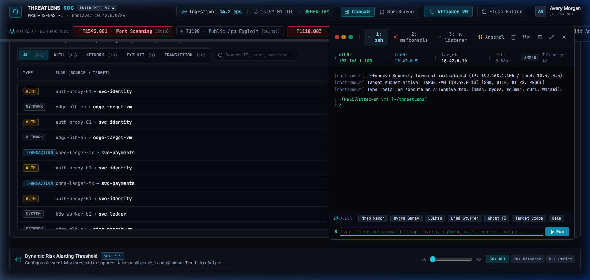
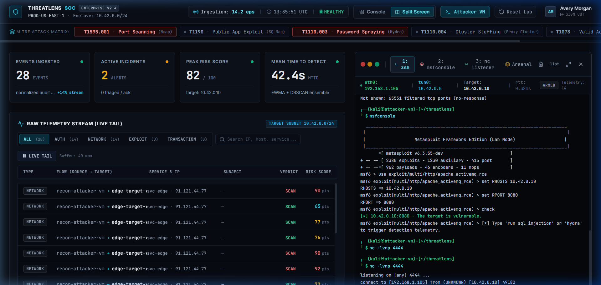
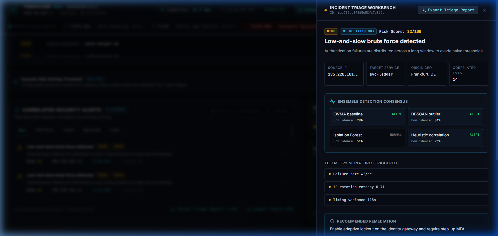
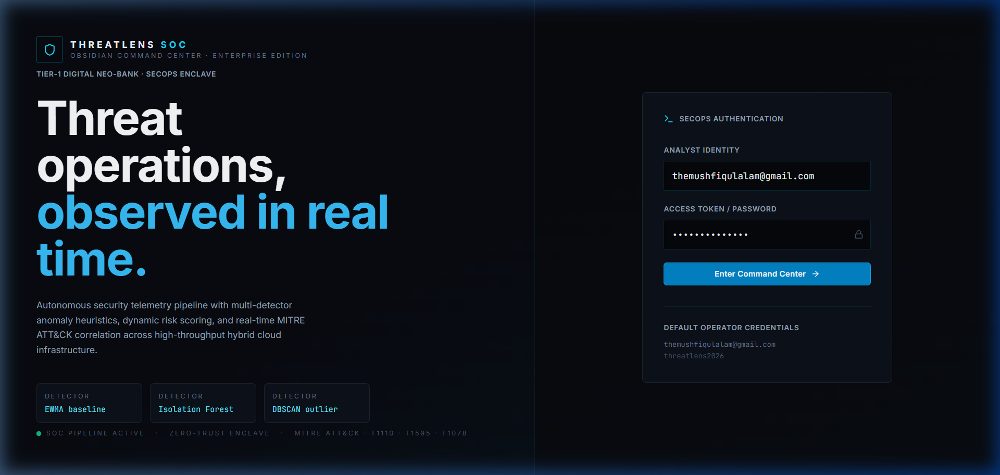

# ThreatLens SOC · Autonomous AI-Based Threat Detection & Incident Response Platform

[](https://opensource.org/licenses/MIT)
[](https://python.org)
[](https://fastapi.tiangolo.com)
[](https://react.dev)
[](https://vitejs.dev)
[](https://attack.mitre.org)
[](https://github.com)

> **ThreatLens** is an enterprise-grade Autonomous Security Operations Center (SOC) platform engineered for high-throughput, mission-critical environments. Built to protect Tier-1 digital banking and hybrid cloud infrastructures processing upwards of 65,000 transactions per second, ThreatLens combines real-time streaming telemetry with a multi-modal machine learning ensemble to detect, score, and isolate sophisticated cyber threats before operational disruption occurs.

---

## 📸 Platform Previews

### 1. Enterprise Command Center Dashboard

*Real-time security telemetry feed, dynamic risk scoring, MITRE ATT&CK kill-chain matrix, high-risk entity leaderboards, and geo-anomaly maps.*

---

### 2. Split-Screen Offensive Terminal & Live Ingestion

*Interactive Kali Linux offensive red team console embedded side-by-side with defensive SOC telemetry for real-time attack validation.*

---

### 3. Incident Triage Workbench & Consensus Breakdown

*Multi-detector ML consensus breakdown (EWMA, Isolation Forest, DBSCAN), forensic telemetry signatures, and automated SDN hypervisor containment.*

---

### 4. SecOps Authentication Gateway

*Enterprise zero-trust login portal with operator credentials and active detector indicators.*

---

## ⚡ The Core Problem ThreatLens Solves

In modern high-velocity infrastructures (such as digital neo-banks processing 65k+ tx/s), legacy perimeter firewalls and threshold-based SIEMs fail:

1. **Evasion via Throttling:** Adversaries deploy *low-and-slow* brute-force routines throttled to 2–4 requests per minute across rotating residential IP pools, seamlessly bypassing static thresholds (e.g., "10 failed logins in 60s").
2. **Ghost Transactions & Latency Spikes:** During high-volume promotional windows, attackers inject unauthorized shadow transactions that produce abnormal latency spikes (`p99 > 4,000ms`) without triggering standard signature rules.
3. **Severe Alert Fatigue:** Naive threshold rules flood Tier-1 SOC analysts with tens of thousands of false positive notifications daily, burying subtle, low-volume breach indicators.

### 🛡️ The ThreatLens Approach
ThreatLens solves these challenges by ingesting high-throughput telemetry in real time and evaluating it through an **Ensemble of Multi-Modal Detectors**, calculating a dynamic 0–100 risk score and giving analysts an interactive sensitivity threshold slider to instantly suppress noise and eliminate alert fatigue.

---

## 🧠 Multi-Modal Machine Learning Consensus

Rather than relying on a single fallible algorithm or static rule, ThreatLens reaches consensus across four complementary detection models:

| Detector Model | Methodology | Primary Threat Target | MITRE ATT&CK |
|---|---|---|:---:|
| **EWMA Moving Baseline** | Exponentially Weighted Moving Average of request interval variance and timing jitter | Low-and-slow password spraying evading static rate-limits | `T1110.003` |
| **Isolation Forest** | Unsupervised tree-based partitioning measuring multi-dimensional feature outliers | Ghost transactions, unauthenticated API replays & latency spikes | `T1078` |
| **DBSCAN Clustering** | Density-Based Spatial Clustering of Applications with Noise across IP subnets | Distributed credential stuffing across rotating residential proxies | `T1110.004` |
| **Heuristic Correlation** | Rule-correlated state machines evaluating protocol anomalies and payload entropy | SYN stealth reconnaissance sweeps & SQL injection exploits | `T1595.001` / `T1190` |

---

## 🚀 Key Features

- **High-Throughput Streaming Ingestion:** Real-time bi-directional WebSocket telemetry (`/api/ws`) delivering live system, authentication, and network telemetry logs with active EPS (Events Per Second) throughput tracking.
- **Dynamic Risk Alerting Threshold Slider:** Configurable sensitivity slider (`50` to `90` points) with one-click operational presets (`50+ All`, `70+ Balanced`, `85+ Strict`) to tune out false positive noise and eliminate Tier-1 alert fatigue.
- **Interactive Kali Linux Red Team Terminal:** Built-in offensive CLI emulator with authentic command parsing, multi-session tabs (`1: zsh`, `2: msfconsole`, `3: nc listener`, `Arsenal`), and tab autocompletion.
- **Automated SDN Containment:** One-click hypervisor enclave isolation to quarantine compromised workloads and freeze illicit payment routes.
- **Audit-Ready Incident Response Reporting:** Dual export capabilities generating structured executive/technical Markdown triage reports (`/api/export/incident-report.md`) and standard SIEM CSV data (`/api/export/alerts.csv`).

---

## 🏗️ System Architecture

```
                                  [ Incoming Telemetry Stream ]
                                                 │
                                                 ▼
                             ┌───────────────────────────────────────┐
                             │    WebSocket Ingestion Engine (/ws)   │
                             └───────────────────┬───────────────────┘
                                                 │
                    ┌────────────────────────────┼───────────────────────────┐
                    ▼                            ▼                           ▼
          [ Auth Telemetry ]           [ Network NetFlow ]         [ Transaction/System ]
          (svc-identity:8080)          (svc-edge / NAT GW)         (svc-payments / ledger)
                    │                            │                           │
                    └────────────────────────────┼───────────────────────────┘
                                                 │
                                                 ▼
                    ┌────────────────────────────────────────────────────────┐
                    │       Multi-Modal Ensemble Detection Engine            │
                    │  ┌──────────────┐ ┌──────────────┐ ┌────────────────┐  │
                    │  │EWMA Baseline │ │ Isolation    │ │ DBSCAN Density │  │
                    │  │ Variance     │ │ Forest Trees │ │ Cluster (IPs)  │  │
                    │  └──────┬───────┘ └──────┬───────┘ └───────┬────────┘  │
                    │         │                │                 │           │
                    │         └───────────┬────┴─────────────────┘           │
                    │                     ▼                                  │
                    │       Dynamic Multi-Factor Risk Scoring (0-100)        │
                    └─────────────────────┬──────────────────────────────────┘
                                          │
                                          ▼
                    ┌────────────────────────────────────────────────────────┐
                    │    ThreatLens SOC Dashboard (React / Obsidian UI)      │
                    │  • MITRE ATT&CK Strip       • Split-Screen Kali CLI    │
                    │  • Configurable Threshold   • Incident Workbench       │
                    └────────────────────────────────────────────────────────┘
```

---

## 🔑 Default Operator Credentials

| Role | Analyst Email | Access Token / Password |
|---|---|---|
| **Lead SecOps Analyst** | `analyst@threatlens.io` | `threatlens2026` |

---

## 🛠️ Quickstart Guide

### Prerequisites
- **Python 3.10+**
- **Node.js 18+** & **npm**

---

### 1. Backend Setup & Startup

```bash
# Clone the repository
git clone https://github.com/Mushfiqul-Alam-17/ThreatLens.git
cd ThreatLens/app/backend

# Create and activate a virtual environment
python -m venv .venv

# On Windows:
.venv\Scripts\activate
# On Linux/macOS:
# source .venv/bin/activate

# Install dependencies
pip install -r requirements.txt

# Start the FastAPI daemon
python -m uvicorn server:app --host 0.0.0.0 --port 8000 --reload
```
*Backend runs on `http://localhost:8000` (API docs at `http://localhost:8000/docs`).*

---

### 2. Frontend Setup & Startup

```bash
# In a new terminal window:
cd ThreatLens/app/frontend

# Install dependencies
npm install

# Start the Vite development server
npm run dev
```
*Frontend runs on `http://localhost:3000`.*

---

## 🎯 Offensive Testing & Scenario Playbooks

ThreatLens includes an interactive Kali Linux console. Launch it from the top bar or run in **Split Screen Mode** to test offensive routines:

| Command | Objective | MITRE Technique |
|---|---|---|
| `nmap -sS -p 22,80,443,5432 -sV 10.42.0.10` | Stealth TCP SYN reconnaissance sweep against edge gateway | `T1595.001` |
| `hydra -l root -P rockyou.txt 10.42.0.10 ssh` | Throttled low-and-slow SSH password spray evading thresholds | `T1110.003` |
| `python3 cred_stuffer.py --proxies 19` | Distributed credential stuffing across 19 residential proxies | `T1110.004` |
| `curl -X POST https://10.42.0.10/api/v1/payments/tx --ghost-replay` | Unauthenticated shadow transaction injection & latency spike | `T1078` |
| `sqlmap -u "https://10.42.0.10/api/ledger?acc=1092" --batch --dbs` | Boolean-based blind SQL injection targeting ledger database | `T1190` |
| `msfconsole` | Metasploit interactive Command & Control framework console | `T1071` |
| `nc -lvnp 4444` | Raw reverse TCP shell listener on port 4444 | `T1059.004` |

---

## 📁 Repository Structure

```
ThreatLens/
├── docs/
│   └── screenshots/               # High-resolution platform UI captures
│       ├── dashboard_overview.png
│       ├── split_screen_mode.png
│       ├── incident_triage_workbench.png
│       └── login_page.png
├── app/
│   ├── backend/
│   │   ├── server.py              # FastAPI server, ML consensus engine, WebSocket hub
│   │   ├── requirements.txt       # Python backend dependencies
│   │   └── .env                   # Configuration & JWT secret
│   └── frontend/
│       ├── src/
│       │   ├── components/        # SOC UI components (AlertFeed, KaliConsole, etc.)
│       │   ├── pages/             # Dashboard and Login views
│       │   ├── context/           # Authentication state context
│       │   ├── lib/               # Axios API client & WebSocket utilities
│       │   └── index.css          # Obsidian Enterprise design tokens & styling
│       ├── package.json           # Frontend dependencies
│       └── vite.config.js         # Vite proxy & build configuration
├── .gitignore                     # Git ignore rules for node_modules, venv, and logs
└── README.md                      # Comprehensive platform documentation
```

---

## 📄 Incident Response Export Format

When an incident is triaged, ThreatLens produces an audit-ready Markdown report (`threatlens_incident_triage_report.md`):

```markdown
# THREATLENS ENTERPRISE SEC-OPS INCIDENT RESPONSE TRIAGE REPORT
**Generated:** 2026-09-14 14:15:00 UTC
**Target Enclave:** Tier-1 Neo-Bank Hybrid Cloud Infrastructure (65,000 tx/s Baseline)
**Auditor / Analyst:** Alex Vance (analyst@threatlens.io)
**Classification:** RESTRICTED // INCIDENT RESPONSE WORKBENCH

## 1. EXECUTIVE SUMMARY & BUSINESS IMPACT
A distributed offensive campaign was detected targeting Neo-Bank authentication gateways...
- Total Correlated Incidents: 3
- Total Telemetry Events Analyzed: 14,312
- Active Ingestion Rate: 14.2 eps

## 2. CORRELATED INCIDENTS & MITRE ATT&CK MAPPINGS
### Incident #1: Low-and-slow brute force detected [SEVERITY: HIGH / RISK: 82/100]
- Case ID: ALT-491028
- MITRE ATT&CK: T1110.003 - Password Spraying
- Attacker Source: 185.220.101.44 (Frankfurt, DE)
- Target Service: svc-ledger on 10.42.0.10
...
```

---

## ⚖️ License

Distributed under the **MIT License**. See `LICENSE` for more information.

---

*Engineered with precision for advanced threat intelligence and real-time security operations.*
